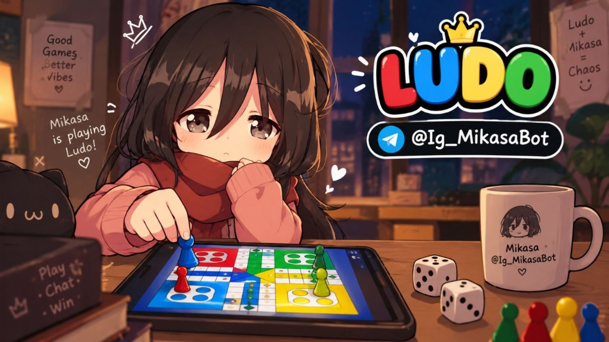

<div align="center">




#### 𝕄𝕚𝕜𝕒𝕤𝕒 𝕃𝕦𝕕𝕠


[](https://t.me/Ig_MikasaBot)
[](https://t.me/Ig_MikasaBot/ludo)


</div>

---

## 🎲 About

Mikasa Ludo is a full-stack Ludo game with live multiplayer, playable as a Telegram Mini App or in the browser. One Render Web Service serves the Vite-built frontend, the `/api/*` endpoints, and the `/ws` multiplayer WebSocket, all on the same origin.

## ✨ Features

- **Live multiplayer rooms.** Real-time play over WebSocket, with lobbies and room codes.
- **Fair dice.** Every roll is generated on the server with `crypto.randomInt`. No hidden streak or luck adjustments. See [FAIRNESS.md](FAIRNESS.md).
- **Turn timer with auto-play.** 20 seconds per turn. A timed-out turn is played automatically, and five in a row removes the player.
- **Chat and reactions.** In-game chat, quick reactions, and big emoji moments.
- **Dark and light boards.** Switch the look of the board to match your mood.
- **Custom tokens.** Personalise your pieces.
- **Match history and profiles.** See past games and your player card.
- **Shareable victory images.** Finish a match and share the result as an image in Telegram.
- **Spectators.** Watch rooms you are not part of.

## 🧰 Tech stack

| Layer | Technology |
| --- | --- |
| Frontend | React, Vite, Tailwind CSS |
| Backend | Node.js, Express, TypeScript (run with `tsx`) |
| Realtime | WebSocket on `/ws` |
| Platform | Telegram Mini App, Render |

## 🚀 Run locally

```bash
npm ci
npm run dev
```

Open <http://localhost:3000>.

Fairness regression check: `npm run test:fairness`. Unit tests: `npm test`.

## ☁️ Deploy to Render

This project ships as a Docker-based Render Blueprint (`render.yaml` and `Dockerfile` in the root).

1. Push this folder to a new GitHub repository.
2. In Render, choose **New → Blueprint** and select that repository.
3. Fill in the variables (see below). Set `DATABASE_URL` to a Neon Postgres connection string if you want profiles and history to survive redeploys.
4. Deploy. Render sets `PORT` and `RENDER_EXTERNAL_URL` automatically, so result links use your public address without extra setup.
5. The first time, and after any dependency change, use **Manual Deploy → Clear build cache & deploy**.

Health check: `/api/health`

> Keep this as **one instance**. Live rooms are held in memory, so multiple instances would not share games.

## ⚙️ Environment variables

Nothing is required for guest play.

| Variable | Default | Purpose |
| --- | --- | --- |
| `TELEGRAM_BOT_TOKEN` | none | Validates Telegram Mini App logins and fetches profile photos. Keep it server-side. |
| `BOT_USERNAME` | `Ig_MikasaBot` | Bot handle without the `@`. Also baked into the Mini App at build time. |
| `MINIAPP_SHORT_NAME` | `ludo` | Mini App short name from BotFather. Also baked in at build time. |
| `MAIN_BOT_USERNAME` | `Ig_MikasaBot` | Handle the "Main Bot" button opens. |
| `DATABASE_URL` | none | Neon Postgres connection string (`postgresql://…?sslmode=require`). Keeps profiles, history, and chat across redeploys. |
| `PUBLIC_URL` | none | Optional. Overrides the public address used for shared result links. |

## 💾 Hosting notes

- **Storage.** With `DATABASE_URL` set, profiles, match history, and chat live in Postgres and survive redeploys. Without it, they are saved to `data/ludo-db.json`, which Render's free filesystem resets on every deploy.
- Free instances can spin down after inactivity. The first request after that is a little slower.
- WebSocket traffic uses the same hostname at `/ws`, so no second service is needed.

## 🤖 Telegram

Open **[@Ig_MikasaBot](https://t.me/Ig_MikasaBot)**, press **Start** once, then launch the **Ludo** Mini App. Players who have opened the bot get their profile photo in the app.

If you host your own copy, create your own bot in @BotFather, set its Mini App URL to your service address, and replace the handle above and `BOT_USERNAME` with yours.

---

<div align="center">

*Roll the dice. Trust the dice.*

</div>
